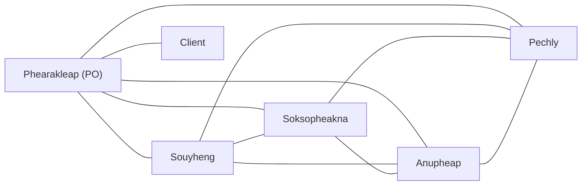

# Communication overhead · Crayon Munchers (v1.0, 2026-10-21)

## Paths

Our team has five members: Phearakleap, Souyheng, Soksopheakna,
Anupheap and Pechly. Phearakleap is the Product Owner (PO).

For a group where everyone communicates with everyone else:

Paths = n(n − 1) / 2

(a) Everyone communicates with everyone, including the client:
6 × 5 / 2 = 15 paths.

(b) All five members communicate internally, but only the PO
communicates with the client:
5 × 4 / 2 + 1 = 11 paths.

| Model | People n | Paths and formula | Minutes/week | Hours/week |
|-------|----------|-------------------|--------------|------------|
| (a) everyone + client | 6 | 6 × 5 / 2 = 15 | 150 | 2.50 |
| (b) client via PO | 5 members + client | 5 × 4 / 2 + 1 = 11 | 110 | 1.83 |

Assumption: each path costs 10 minutes of total coordination effort
per week, including writing questions, reading replies and clarifying
decisions. This is an estimate that we will review after two weeks.

Team capacity: 5 members × 6 hours = 30 person-hours/week.

- Model (a): 2.50 / 30 × 100 = 8.33% overhead.
- Model (b): (110 / 60) / 30 × 100 = 6.11% overhead.

Using the PO as the client contact saves four paths and 40 minutes
of coordination per week.

## Our paths (model b)

The diagram has ten internal team paths and one PO–client path,
giving 11 paths altogether.

## Two practices

1. **Use GitHub Issues as the shared work record.**
   Each task will have an owner, acceptance criteria and progress
   updates. Decisions made in Telegram will be recorded in the
   relevant issue so members can find answers without repeatedly
   asking each other.

   We estimate that this reduces internal coordination from
   10 to 5 minutes per path per week, including writing and reading
   the updates. Client coordination remains 10 minutes.

   New overhead: 10 × 5 + 1 × 10 = 60 minutes = 1.00 hour/week,
   or 3.33% of team capacity.

2. **Prepare one weekly client agenda through the PO.**
   Members will add their questions to a shared issue before the
   client discussion. Phearakleap will group related questions,
   discuss them with the client and record the answers for everyone.

   We estimate that this reduces the client path from 10 to
   5 minutes per week. Applied together with practice 1:

   New overhead: 10 × 5 + 1 × 5 = 55 minutes = 0.92 hours/week,
   or 3.06% of team capacity.

These practices reduce the cost per path; the 11 possible
communication paths remain available.

## A sixth member in week 11?

With six team members and only the PO communicating with the client:

Paths = 6 × 5 / 2 + 1 = 16.

Compared with five members:

- Additional paths: 16 − 11 = 5.
- Percentage increase: 5 / 11 × 100 = 45.45%.
- At the original 10 minutes per path:
  16 × 10 = 160 minutes = 2.67 hours/week.
- This is 50 more minutes of coordination per week, before onboarding.

We would decline the sixth member in week 11 because onboarding
and extra coordination near the deadline could slow delivery,
consistent with Brooks’s law.

## Reflection: the essential difficulty we expect first

We expect complexity to affect ITC Club Hub first because its
business rules interact. Our problem statement requires capacity
limits, no duplicate registrations and a cancellation deadline
24 hours before an event. For example, cancelling a registration
should free a seat, but a cancellation after the deadline must be
rejected. If different members implement these rules separately
without agreeing on their interactions, the application could
show an available seat while still counting the original registration.

During week one, we will list the rules and ask the client to
clarify uncertain cases, including cancellation exactly at the
deadline. In week two, we will draw the registration states and
agree on shared interfaces and responsibilities. In week three,
we will test combined scenarios, such as a full event followed
by an allowed cancellation and another registration. In week four,
we will demonstrate the complete flow to the client and record
any corrections in GitHub Issues.

- I have other work and responsibilities, so my time is limited. I’ll take smaller tasks and ask teammates when Club Hub’s rules get confusing. Anupheap
- Much like pheap, I too will be more busy than usual juggling a variety tasks around. I'll try to allocate the appropriate tasks to this project's members as best as I can. Ung Phearakleap
