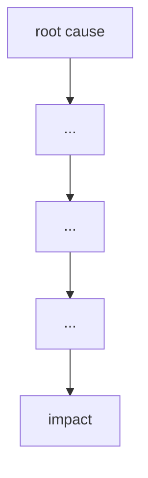

# Failure case analysis · Northeast Blackout, 2003 (v1.0, 2026-10-16)
Authors:
- 
-  
- Ung Phearakleap - Root Causes
- Kouch Souyheng - Practices
- 

## 1. Context

## 2. Timeline
| Date | Event |
|------|-------|

## 3. What failed
<one paragraph>

## 4. Root causes
| # | Root cause | Type | Essential difficulty | Why |
|---|------------|------|----------------------|-----|
| R1 | EMS Software Failure          | technical | complexity | The scale of the code was too large to the point an overflow occured, freezing the alarm processor loop. |
| R2 | Inadequate vegetation (Trees) management          | process | conformity | The power infrastructure had to conform to a harsh environment with unkept trees and heat that causes the lines to sag. |
| R3 | Lack of Situational Awareness at FE          | process | invisibility | FE operators can't check on the status of the software and tranmission grids when the UI froze. |

## 5. Practices that would have prevented or limited it
| Root cause | Practice | Chapter |
|------------|----------|---------|

## 6. Lessons for ITC Club Hub
1.
2.

## 7. Sources
1. U.S.-Canada Power System Outage Task Force, Final Report on the August 14, 2003 Blackout in the United States and Canada: Causes and Recommendations, 2003, https://www.energy.gov/sites/prod/files/oeprod/DocumentsandMedia/BlackoutFinal-Web.pdf> (primary)