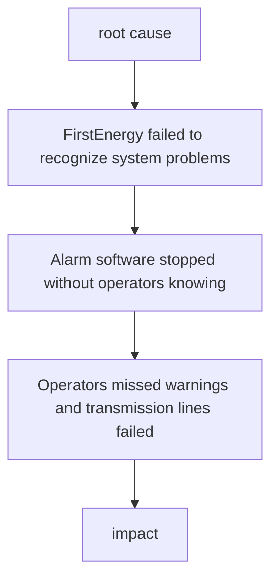

# Failure case analysis · Northeast Blackout, 2003 (v1.0, 2026-10-16)
Authors:
- Ou Pechly - Context and Timeline
- Yam Soksopheakna - What failed
- Ung Phearakleap - Root Causes
- Kouch Souyheng - Practices
- 

## 1. Context
The 2003 Northeast blackout (U.S. and Canada) was investigated by a joint Task Force co-chaired by the U.S. Energy Secretary and Canada’s Natural Resources Minister. It hit part of the Eastern Interconnection, a single grid where power can’t be stored and flows by physics, and which must stay secure if any one major element fails (the N-1 rule). About 50 million people lost power, for up to 4 days in parts of the U.S., at a U.S. cost of roughly $4-10 billion. It matters because it was preventable; FirstEnergy’s poor voltage planning, failed alarm systems and untrimmed trees, plus weak coordination and unenforceable standards, turned a manageable problem into a massive cascade.
## 2. Timeline
<<<<<<< HEAD
| Date/Time        | Event                                                                                                                                |
|----------------- |--------------------------------------------------------------------------------------------------------------------------------------|
|13:31             | Eastlake 5 tripped at 13:31:34.                                                                                                      |
|14:14 to 15:59    | FirstEnergy’s alarm and computer systems fail, leaving operators unaware of the problem.                                             |
|15:05 to 15:41    | The Harding-Chamberlin line tripped at 15:05:41, Hanna-Juniper at 15:32:03 and Star-South Canton at 15:41:35, all from tree contact. |
|15:39 to 16:08    | Sixteen 138-kV lines eventually failed.                                                                                              |
|16:05:57          | Sammis-Star 345-kV line trips, triggering the cascade.                                                                               |
|16:10:46 to 16:12 | The grid broke into islands. The last step listed, Ontario-eastern Michigan lines separating, was at 16:11:57.                       |
|----------------- |--------------------------------------------------------------------------------------------------------------------------------------| 
=======
| Date/Time       | Event                                                                                                                                |
|-----------------|--------------------------------------------------------------------------------------------------------------------------------------|
|13:31            | Eastlake 5 tripped at 13:31:34.                                                                                                      |
|14:14 to 15:59   | FirstEnergy’s alarm and computer systems fail, leaving operators unaware of the problem.                                             |
|15:05 to 15:41   | The Harding-Chamberlin line tripped at 15:05:41, Hanna-Juniper at 15:32:03 and Star-South Canton at 15:41:35, all from tree contact. |
|15:39 to 16:08   | Sixteen 138-kV lines eventually failed.                                                                                              |
|16:05:57         | Sammis-Star 345-kV line trips, triggering the cascade.                                                                               |
|16:10:46 to 16:12| The grid broke into islands. The last step listed, Ontario-eastern Michigan lines separating, was at 16:11:57.                       |

>>>>>>> ccf08c8f0affc317c237b54b8bee5249d0f7ed8c

## 3. What failed
In Ohio, FirstEnergy failed to recognize weaknesses in its power system, and its alarm software stopped working without operators noticing. Several transmission lines then failed, destabilizing the power grid and causing the blackout to spread. The main contributing factors were a poor understanding of the system, a lack of awareness, and poor coordination and response.

## 4. Root causes
| # | Root cause | Type | Essential difficulty | Why |
|---|------------|------|----------------------|-----|
| R1 | EMS Software Failure          | technical | complexity | The scale of the code was too large to the point an overflow occured, freezing the alarm processor loop. |
| R2 | Inadequate vegetation (Trees) management          | process | conformity | The power infrastructure had to conform to a harsh environment with unkept trees and heat that causes the lines to sag. |
| R3 | Lack of Situational Awareness at FE          | process | invisibility | FE operators can't check on the status of the software and transmission grids when the UI froze. |

## 5. Practices that would have prevented or limited it
| Root cause      | Practice                        | Chapter |
|-----------------|---------------------------------|---------|
|EMS Software Failure                        |  Deploy automated application health  and fix software bug check               |         |
|Inadequate vegetation (Trees) management    | Trimming trees in proper way and have regular trimming schedule                         |---------|
|Lack of Situational Awareness at FE         | Backup wall map and require discussion between IT and operators

## 6. Lessons for ITC Club Hub
1. Monitor system health: Implement automated monitoring to detect server errors, software crashes, and database failures before they affect users.
2. Improve error handling: Test the system regularly, fix software bugs, and prevent a single failure from crashing the entire application.
3. Maintain situational awareness: Provide administrators with a dashboard showing system status, errors, and service availability.
4. Prepare backup and recovery plans: Maintain regular database backups and recovery procedures to minimize data loss and downtime.
5. Improve team communication: Ensure developers, administrators, and other team members communicate quickly when problems occur.

## 7. Sources
1. U.S.-Canada Power System Outage Task Force, Final Report on the August 14, 2003 Blackout in the United States and Canada: Causes and Recommendations, 2003, https://www.energy.gov/sites/prod/files/oeprod/DocumentsandMedia/BlackoutFinal-Web.pdf> (primary)