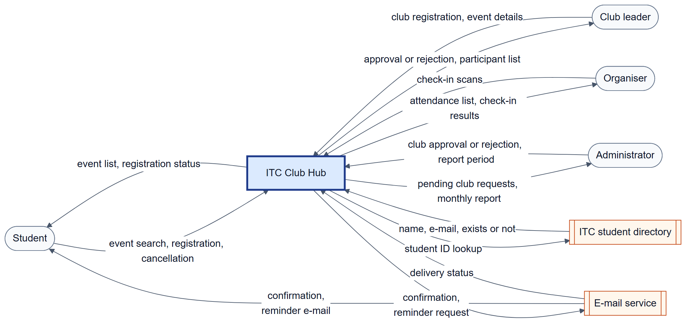
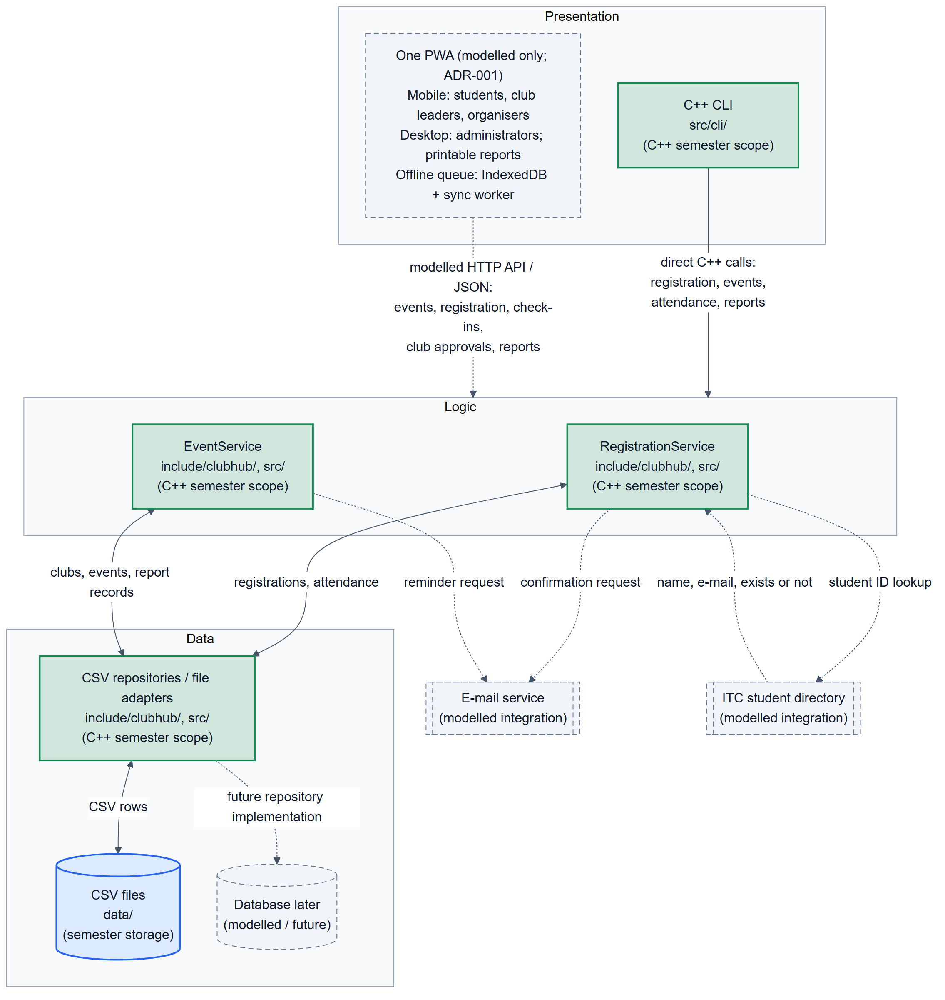
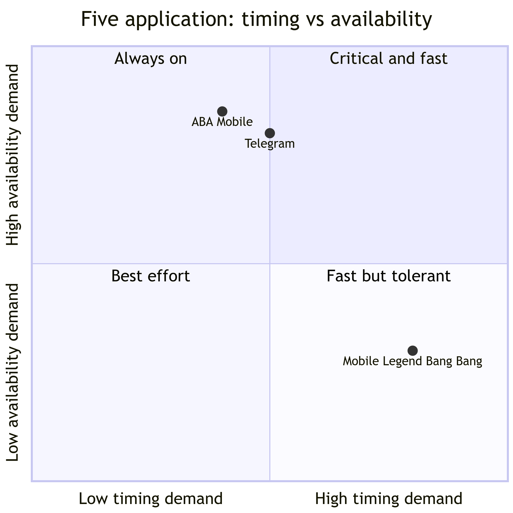

# Lab-02 · Types of Applications: What Changed
Version 1.0 · 2026-11-4 · Team: Crayon Munchers

## Files
---

| File | Task | Description | Main author |
|------|------|-------------|-------------|
| **lab02/app-classification.md** | 1 | Five applications classified by kind, type, where the code runs, architecture and top 3 qualities | Ou Pechly |
| **lab02/app-quadrant.mmd** | 1 | Quadrant chart: timing demand against availability demand | Kouch Souyheng |
| **lab02/adr-001-application-type.md** | 2 | User groups, four options, weighted matrix, deal-breakers, decision (PWA), consequences, rejected options | Ung Phearakleap |
| **lab02/quality-scenarios.md** | 3 | Six quality attribute scenarios QAS-01..06 and the priority table | Ou Pechly + Yam Soksopheakna |
| **lab02/context-diagram.mmd + (*.png)** | 4 | Context diagram: Club Hub as one black box, four roles, two external systems, 13 labelled arrows | Buntong Anupheap |
| **lab02/architecture.mmd + (*.png)** | 4 | Three-tier sketch with implemented and modelled parts mapped to folders | Buntong Anupheap |
| **include/clubhub/event.hpp**, **src/event.cpp** | 5 | **Event** class with validation, **parseTimePoint**, **formatTimePoint** (**std::chrono** start time) | Ung Phearakleap |
| **include/clubhub/event_csv.hpp**, **src/event_csv.cpp** | 5 | CSV loader that collects bad rows with line numbers | Kouch Souyheng |
| **src/cli/main.cpp**, **CMakeLists.txt**, **data/events.csv** | 5 | **list-events** command (all console output), build targets **clubhub_core** and **clubhub**, sample data with the invalid row E004 | Ung Phearakleap |
| **lab02/challenge/offline-checkin.md** | Challenge | Sequence diagram, six conflict rules, scenario QAS-07 and trade-offs | Buntong Anupheap |
| **include/clubhub/queued_checkin.hpp** | Challenge | **QueuedCheckin** with the idempotency key **localId** and the server-side **AppliedCheckins** | Buntong Anupheap |

## Inputs reused
---

| Input | File | Version or commit |
|-------|------|-------------------|
| Problem statement and stakeholder list | **lab01/team-charter.md** | **<git log -1 --format=%h -- lab01/team-charter.md>** (if missing, the fallback text from the lab was used) |
| Team roles and decision rules | **lab01/decisions.md** | **<git log -1 --format=%h -- lab01/decisions.md>**; ADR-001 added as a line |

## Diagrams
---

### Context diagram (Task 4):
<p align="center">
    
</p>

### Architecture (Task 4):
<p align="center">
    
</p>

### Quadrant chart (Task 1):
<p align="center">
    
</p>

## How to build and run

******
```
cmake -S . -B build && cmake --build build
./build/clubhub list-events data/events.csv
echo $?
grep -rn "iostream\|cout\|ifstream" include/ src/event*.cpp
``` 
******

## Change log

| Date | Version | What changed | By |
|------|---------|--------------|----|
| 2026-10-31 | 1.0 | Added the app-classification and app-quadrant files for task 1 | Ou Pechly |
| 2026-11-1 | 1.0 | Completed adr-001-application-type | Ung Phearakleap |
| 2026-11-1 | 1.0 | Completed their respective parts in task 1, waiting for other members to contribute | Ou Pechly + Kouch Souyheng |
| 2026-11-1 | 1.0 | Completed architecture and context-diagrams | Buntong Anupheap |
| 2026-11-2 | 1.0 | Completed TODOs event.cpp and event.hpp | Ung Phearakleap |
| 2026-11-2 | 1.0 | Completed TODOs event_csv.cpp and event_csv.hpp | Kouch Souyheng |
| 2026-11-2 | 1.0 | Completed Task 5 except from the README | Ung Phearakleap |
| 2026-11-4 | 1.0 | Completed QAS 2, QAS 3 and priority table | Yam Soksopheakna |
| 2026-11-4 | 1.0 | Completed the first quality scenarios | Kouch Souyheng |
| 2026-11-4 | 1.0 | Added the README | Ung Phearakleap |
| 2026-11-4 | 1.0 | Completed QAS 6 | Ung Phearakleap |
| 2026-11-4 | 1.0 | Completed QAS 5 | Ou Pechly |
| 2026-11-4 | 1.0 | Completed one app classification (ABS System) | Ung Phearakleap |
