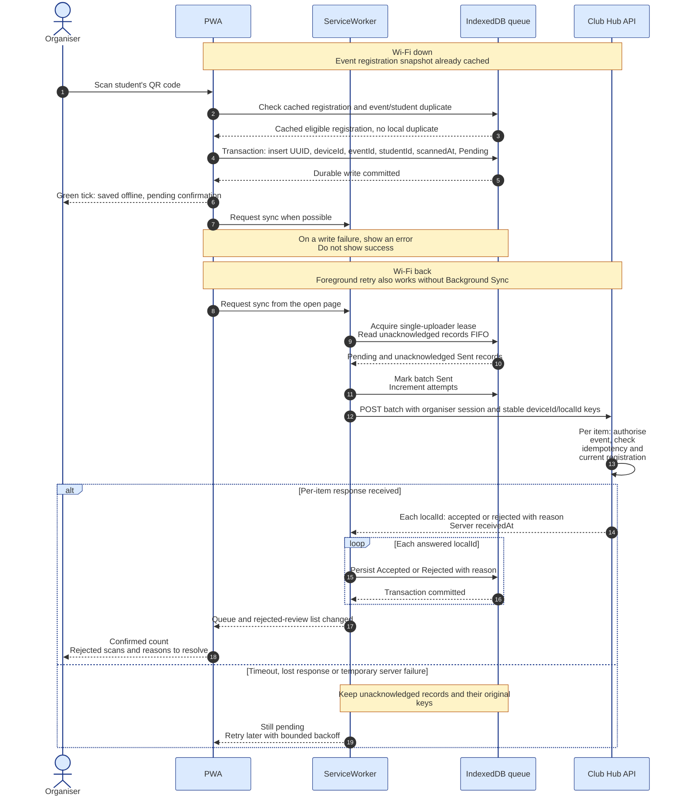

# Lab 02 challenge: Offline-first check-in for the PWA

Version 1.0 | 2026-11-04 | Team: Crayon Munchers | Review: pending

## Scenario and scope

Debate Night is in Amphi A. Two organisers use one phone each at two doors;
120 students arrive in 10 minutes and Wi-Fi can disappear for five minutes.
Check-in must acknowledge a saved scan without waiting for the network.
This extends the PWA selected in [ADR-001](../adr-001-application-type.md).
The PWA, ServiceWorker, IndexedDB and API below are modelled. The accompanying
[C++ queue header](../../include/clubhub/queued_checkin.hpp) is an executable
reference model, not a browser implementation or durable storage engine.

Before opening the doors, each authorised organiser downloads the event's
registration snapshot. The local cache needs event IDs, student IDs and
registration status; it does not need phone numbers or e-mail addresses.
A matching cached registration permits a provisional offline check-in.
Unknown IDs and local duplicates show a message instead of a new green tick.
The server checks the current registration again when the scan synchronises.

## Offline scan and synchronisation

[Open the PNG preview](offline-checkin.png).

A green offline tick means the scan was saved on that phone. It is provisional,
so the screen also shows a pending count. A server rejection must reach the
organiser's review list with a reason and a way to request manual resolution.
The system cannot guarantee that an already admitted student can be turned
away retroactively; the organiser resolves that operational consequence.

The ServiceWorker may upload when supported. The open PWA runs the same sync
routine on reconnect and provides a Retry button when Background Sync is
unavailable. Both paths share a single-uploader lease in IndexedDB. A lease
expires after a crashed uploader so another attempt can resume. An item with
no final answer stays retryable; only acknowledged items become terminal.

## Conflict rules

The server is authoritative for registrations and final attendance. Each item
is processed in a transaction, with a unique attendance key `(eventId, studentId)`
and a stored result for `(deviceId, localId)`. Server validation also checks the
organiser's permission for that event; an idempotency key is not authentication.

| Case | Winner | What the organiser sees | What is stored |
| --- | --- | --- | --- |
| Same student scanned at both doors, using two distinct local IDs | First valid server transaction creates attendance; the other valid scan merges into that attendance | Both phones can show provisional offline success. On sync, the second shows "already checked in" and the attendance total increases once | One canonical attendance row; both scan IDs, device IDs and receipt times remain in the audit trail. Both items are acknowledged as accepted, with a duplicate outcome for the second |
| Registration cancelled on the server before the offline scan synchronises | Current server cancellation wins, even if the cached roster was older | The scan moves from pending to rejected: "registration cancelled; ask organiser to review" | Cancellation stays in place; rejected scan, reason and timestamps are retained; no new attendance row |
| Student has no registration | Server registration records win | If absent from the local cache, the phone immediately shows "not in cached roster". If a stale or altered record reaches the API, the review list shows "not registered" | Server records a rejected uploaded item and reason; it creates no registration or attendance |
| Upload is retried after the server applied it but its response was lost | Previously stored result for the same `(deviceId, localId)` wins | The original accepted/rejected answer returns; no second check-in appears | The original result and attendance remain unchanged. A retry with the same key but different event/student data is rejected as key reuse |
| Phone clock is seven minutes wrong | Server registration state and server receipt order win; phone timestamps do not decide conflicts across doors | Local scan time is labelled as device time; synchronisation shows server confirmation time | Keep both device `scannedAt` and server `receivedAt`. Use server transaction order for the canonical record and local insertion order within one phone |

The first server receipt is an auditable ordering rule, not proof of which
physical door saw the student first. We do not compare phone clocks to make
that claim. The server keeps duplicate device evidence without inflating totals.

## C++ queue contract and idempotency

`QueuedCheckIn` contains the device-generated UUID `localId`, device, event and
student IDs, `std::chrono::sys_seconds scannedAt`, attempt count, `SyncState`
and an optional rejection reason. Generate the UUID once when capturing the
scan and persist it before showing success. The API's unique
`(deviceId, localId)` key and stored per-item result make a retried upload
idempotent: it can acknowledge again while applying attendance at most once.
The separate `(eventId, studentId)` constraint handles distinct scan IDs from
two doors.

| Operation | Behaviour |
| --- | --- |
| `enqueue(item)` | Requires non-empty IDs and one device per queue. Returns false for a repeated local ID or student/event pair, including retained terminal records. A fresh capture starts Pending with zero attempts |
| `pending()` | Returns Pending and unacknowledged Sent items in capture/insertion order, oldest first. It does not sort by an unreliable phone clock |
| `markSent(localId)` | Marks a real upload attempt and increments attempts. Returns false for a terminal record |
| `markAccepted(localId)` | Marks an unacknowledged item Accepted; removes it from future uploads |
| `markRejected(localId, reason)` | Marks an unacknowledged item Rejected and retains the non-empty reason for the organiser |
| `items()` | Read-only view of all retained records, including the rejected-review list |

Unknown IDs in acknowledgement methods throw `std::out_of_range`. Duplicate
acknowledgements are harmless, and a late conflicting answer cannot overwrite
a terminal state. The server must return its original decision for the same
idempotency key. Retain terminal local records during the event to prevent a
repeat local scan; final retention and deletion policy is outside this lab.

The C++ class uses an in-memory vector and performs no console or file I/O.
The modelled PWA must implement the same transitions with IndexedDB transactions;
it must also persist the attempt counter, lease and server receipt metadata.
This header does not add a web application, API or a new CLI command to Task 5.

## Trade-offs against the six quality scenarios

The [Task 3 file](../quality-scenarios.md) currently contains scenario headings
and empty tables. These links identify the intended attributes; they do not
claim that the team's scenario targets have already been written or verified.

| Scenario | Effect of offline-first check-in | Cost or limitation |
| --- | --- | --- |
| QAS-01 Availability | A five-minute network loss does not prevent locally saved scans | Final server confirmation is delayed, and a cleared or failed local store can lose unsynchronised work |
| QAS-02 Check-in performance | The door waits for a local transaction instead of a network round trip | Reconnection creates a batch workload; count final per-item acknowledgements rather than assuming the whole batch succeeded |
| QAS-03 Usability | Immediate feedback keeps the queue moving | Provisional success and later rejection need clear pending badges and a visible review list |
| QAS-04 Security | The cached roster limits collection to the IDs needed for this event | Personal IDs now live on phones; restrict access and event scope. The server rechecks permissions and registrations |
| QAS-05 Modifiability | Queue transitions and server conflict rules have explicit contracts | The team must keep C++ reference behaviour, browser storage and API results consistent |
| QAS-06 Portability | Foreground retry supports the PWA when browser Background Sync is absent | Verify storage, reload and foreground retry on Android Chrome, iPhone Safari and the desktop web view selected in ADR-001 |

## Additional scenario: Five-minute network outage

This is a challenge scenario, separate from the exactly six required Task 3
scenarios. Its figures are proposed acceptance targets, not measured results.

| Part | Content |
| --- | --- |
| Source | Two authorised organisers with one phone per door at Debate Night |
| Stimulus | Wi-Fi drops for five minutes while QR scans continue |
| Environment | Amphi A; 120 arrivals in 10 minutes, with up to 60 scans during the outage; both phones have already cached the event roster and have sufficient local storage |
| Artifact | PWA check-in view, IndexedDB queue, sync coordinator and Club Hub API |
| Response | Save each eligible scan locally before showing a provisional green tick; retain records through a reload; upload when connectivity returns; display final per-item outcomes and rejection reasons |
| Response measure | At least 95% of eligible scans show saved-offline feedback within 1 second, and all within 2 seconds. After a phone reload, retain 100% of committed scans. Once a stable network returns, all 60 queued scans receive a final outcome within 30 seconds. Two-door duplicate scans create exactly 1 attendance row per event/student pair |

To check this, preload a known roster on two phones, disable their network for
five minutes, capture 60 eligible scans including two-door duplicates, and
reload one phone halfway through. Restore a stable connection, record local
acknowledgement and final-outcome times, and compare queue IDs, rejected items
and the canonical attendance count. Repeat the upload after a deliberately
lost response, cancel one registration before sync, submit an unknown student,
and offset one phone clock by seven minutes to exercise all conflict rules.
