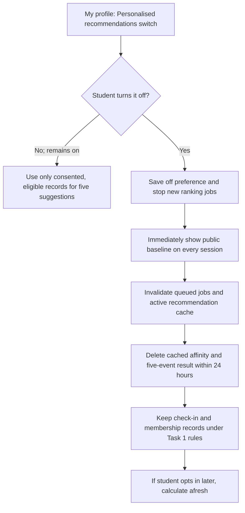

# AI feature proposal: "Recommended for you"
Version 0.1 · 2026-11-12 · Authors: Crayon Munchers

**Status:** Proposal for the ITC Clubs Office to accept or reject. No recommendation feature or new use of attendance data is authorised by this document alone.

## 1 Problem and non-personalised baseline

Students can miss events outside the chat groups and clubs they already know. The request is for five upcoming suggestions that help a student discover relevant events without hiding the full event list or making registration depend on a recommendation. The [original problem statement](../lab-01/problem-statement.md) already calls for one browsable list of every approved club's events.

**Baseline first:** Show all upcoming, approved events by start time, plus an "Events this week" list and a rotating "Discover a club" selection. Rotate across clubs so those with fewer events still appear. These lists are the same for every student, use only public event details, and require no student records or personal data. Students can filter and search the full list themselves. Run this baseline for one month and ask students whether it solves the discovery problem before building personalised ranking.

## 2 Data needed

The inventory reference is [Task 1's data inventory](data-inventory.md). "In inventory?" distinguishes fields already listed there from event catalogue fields and proposed recommendation data. Personalisation would use a small, explainable rule, not a prediction model: give priority to upcoming events from clubs with at least two **verified** check-ins by the student in the last 12 months; consider current club memberships; reserve at least two of five places for clubs whose events the student has never attended. Rotate ties by soonest start and club, rather than by prior recommendation clicks or popularity. If fewer than five eligible events exist, show all of them. Do not use registrations that were cancelled or never checked in.

| Field | Source | In inventory? | New purpose / consent? | Minimisation |
|-------|--------|---------------|------------------------|--------------|
| `studentId` | Existing account record, `data/students.csv` | Yes | Used only to join the consenting student's records; requires the new recommendation purpose to be disclosed | Use an internal identifier during calculation; never show it in explanations, exports or recommendation logs |
| Verified attendance: `studentId`, `eventId`, check-in status and event date | Existing `data/registrations.csv` and event catalogue | Yes, as `attendance` | **Yes.** Task 1 permits check-in and monthly reporting, not ranking; require a separate, affirmative recommendation opt-in before reading it for this purpose | Read only the last 12 months of identified check-ins; exclude cancelled/no-show records; keep Task 1's 12-month aggregation rule |
| `clubMemberships` | Existing `data/memberships.csv` | Yes | **Yes.** Using membership to rank events is a new purpose covered by the same separate opt-in | Use current club IDs only; do not keep old memberships or show membership to another club |
| Event ID, club ID, start time, approval and open/available status | Public event catalogue | No separate row in Task 1 student-data inventory | Needed for both baseline and recommendations; no student consent for public event metadata | Only upcoming, approved, open events; use capacity only as an eligibility flag, not a ranking score |
| Recommendation preference: on/off and choice time | Student's My profile choice | No | **Yes.** New preference must be recorded to respect withdrawal and avoid restarting the feature accidentally | Store one current flag and timestamp; no history of switches or reason for refusal |
| Derived club affinity and five-event result | Calculated from opted-in records | No | **Yes.** This is new derived personal data, even though no machine learning is used | Calculate on demand where possible; if cached, keep only the latest result, scoped to that student, with a maximum 24-hour lifetime; never export to clubs or sponsors |

**Task 1 decisions that would change if approved:** Amend the `attendance` and `clubMemberships` rows to add the optional recommendation purpose and separate opt-in, while keeping their access limits and deletion rules. Add the preference and any cached derived result to the inventory, retention rules and privacy notice. The `studentId` row gains an internal linking use, not wider visibility. Add event catalogue fields only if the office's inventory covers non-student data. The Task 1 decisions to drop date of birth, photo, gender and Telegram handle remain. Email, phone, faculty/year, free text, inferred disability and inferred income must not be recommendation inputs. Organisers and club leaders still cannot inspect another club's students' attendance.

## 3 Bias risks

Fairness checks use **exposure**: a recommendation slot actually shown in the five-event list, counted once per student per day to stop frequent visitors dominating the measure. The clubs office reviews an aggregate monthly report; no named student histories or individual recommendations go to club leaders. "Eligible events" means upcoming, approved, open events on the day a list is shown.

| Risk | Who is harmed | Mitigation | Fairness check (metric, threshold) |
|------|---------------|------------|------------------------------------|
| New students and students who have not checked in have no history | New and less active students | Show five baseline events when there is no verified history; never display an empty or low-quality list because of cold start | On days with at least five eligible events, **100%** of opted-in students with zero check-ins receive five events; compare with the same rate for students with history |
| Recommended events get more registrations, creating a popularity feedback loop | Clubs and interests outside the early winners | Do not rank by recommendation clicks or past exposure; reserve at least two of five slots for clubs whose events the student has never attended | Where at least two eligible unseen-club events exist, **at least 95%** of rendered lists contain two such events; otherwise record the shortage and fill from the baseline |
| Attendance reflects time, transport, money or access barriers, not just interest | Students who could not previously attend | Never treat non-attendance as dislike; allow the full unranked list and student-controlled filters; include new-club events regardless of attendance count | Among students with only one verified check-in in 12 months, **100%** receive five suggestions when five events are eligible; at least **40%** of their slots go to unseen clubs when two are available |
| Large clubs crowd out smaller clubs | Clubs with fewer than 20 current members and students seeking niche activities | Rotate ties across clubs and reserve exploration slots; avoid registration totals as a personal ranking input | Monthly, small clubs' share of recommendation slots is **at least 80% of their share of eligible event opportunities**. Define fair share as their eligible event count divided by all eligible event counts across the same displays; report numerator, denominator and ratio |
| A cancelled registration or bad check-in is mistaken for attendance | Students who cancelled or whose record was corrected; clubs receiving misleading exposure | Base affinity only on verified check-ins and apply corrections before ranking | Monthly audit of up to 100 input records: **0** cancelled, no-show or corrected-away records counted as verified attendance; pause personalisation if any are found |

The third check measures equal service for low-history students; it cannot prove fairness by disability or income, which the system should not collect or infer for this feature. The office should also review student complaints and the public event catalogue for access and cost barriers. If there are too few events to calculate a stable small-club ratio, report the counts and review the following month rather than claiming a pass.

## 4 Transparency

**"Why am I seeing this?" example for a Robotics Club workshop:**

> You chose to turn on personalised recommendations. You checked in to two Robotics Club events in the last 12 months, and this workshop is upcoming and open for registration. We also include events from clubs you have not attended so you can discover something new. You can see all events or turn recommendations off in My profile.

For an exploration slot, replace the attendance sentence with: "You have not attended an event from this club; we included it to help you discover another club." Do not imply that a student attended an event if the record is only a registration.

**Publishable ranking description:** "For students who opt in, Club Hub considers verified check-ins from the last 12 months and current club memberships. It suggests upcoming, approved events with places available, gives some priority to clubs attended at least twice, and reserves at least two of five places for clubs the student has not attended. Ties rotate across clubs and then use event start time. We do not use contact details, demographics, free text, clicks or payments. Every student can still browse all events, and the recommendation switch starts off."

## 5 Opt-out design

Use **opt-in, off by default**, because attendance was collected for check-in and reporting, and a recommendation is optional. Place a clearly labelled **Personalised recommendations** switch in **My profile → Privacy and preferences**, separate from SMS and email reminder choices. Explain the data inputs and deletion result beside the switch. Turning it on records an affirmative choice. Turning it off immediately replaces the five-event list with the public baseline, stops new ranking jobs, invalidates active sessions and queued work for that student, and deletes any cached affinity and result within 24 hours. The original attendance and membership records remain under their existing Task 1 purposes and retention periods. Do not put derived results in logs or exports; any residual encrypted backup copy follows the existing 30-day rotation and cannot be restored into active recommendation use. A later opt-in computes a fresh result from then-eligible records; it does not restore the deleted profile.

## 6 Recommendation

**Decision: GO WITH CONDITIONS**, not before Sprint 2 and only after the non-personalised baseline has been live for one month. If the baseline already solves discovery well enough, or the clubs office cannot meet these conditions, do not build personalisation.

1. The ITC Clubs Office accepts the new purpose in writing; update the Task 1 inventory, privacy notice and retention rules before implementation. The feature is opt-in and off by default; switching it off removes derived data within 24 hours.
2. Use only verified attendance from the last 12 months, current club memberships and public event data. No phone, email, free-text, demographic, inferred income or inferred disability input; no individual attendance shared with club leaders.
3. Reserve at least two of five slots for clubs the student has never attended whenever two eligible events exist; keep all approved events independently browsable.
4. Run the monthly exposure and data-quality checks in Section 3. Small clubs must receive at least 80% of their fair share of recommendation slots. Publish aggregate results and student-facing ranking rules. **Owner of the fairness check: ITC Clubs Office**, with the team supplying the aggregate report and a way to pause the feature if thresholds fail.
