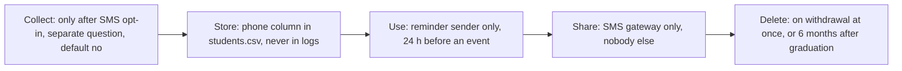

# Data inventory · ITC Club Hub
Version 0.1 · 2026-11-10 · Authors: Crayon Munchers

| Field | Subject | Purpose | Legal basis / consent | Retention | Who can see it | Stored in | Decision |
|---|---|---|---|---|---|---|---|
| studentId | student | Identify the student, block double registration | Necessary for the service | Until the student leaves the institute, then deleted with the account | Student (full), organiser (masked, e.g. e2******7), administrator (full) | data/students.csv | **Mask** for organisers: the name plus a masked ID is enough to find someone at the door |
| name | student | Show who is registered, check-in at the door | Necessary for the service | Until the student leaves the institute | Student, organiser of that event, club leader of that club, administrator | data/students.csv | **Keep**: check-in needs a human-readable identity |
| email | student | Send confirmations and optional email reminders | Necessary for the service (account, confirmations), consent for reminders | Until the student leaves the institute | Student, administrator, never shown to organisers or leaders | data/students.csv | **Keep**: needed for account contact |
| phone | student | SMS reminder 24 h before an event, only if chosen | Consent, opt-in, withdrawable in My profile | Deleted at once on withdrawal, otherwise 6 months after graduation | Nobody on screen, read only by the reminder sender | data/students.csv | **Keep optional**: SMS reaches students without mobile data |
| clubMemberships | student | Show "my clubs", allow club leaders to manage members | Necessary for the service | Until the student leaves the club, then deleted | Student, leader of that club, administrator | data/memberships.csv | **Keep**: required by club management |
| attendance | student | Check-in record, monthly activity report | Legitimate interest: the institute must know whether clubs run real activities | Identified for 12 months, then aggregated to counts per event | Organiser (own events), administrator | data/registrations.csv | **Aggregate**: after 12 months only counts are needed for the report |
| dateOfBirth | student | None: no feature, rule or report uses it | None | Not collected | Nobody | none | **Drop**: "might be useful" is not a purpose |
| photo | student | Candidate: a profile picture for the check-in list | None, would need consent | Not collected | Nobody | none | **Drop**: the name and masked ID already identify the person at the door |
| faculty and year | student | Candidate: sponsors want a breakdown by faculty | Would need consent, no feature requires it | Not collected at the student level | Administrator only (as counts) | none | **Aggregate**: the monthly report may show counts per faculty, with no individual stored field |
| gender | student | Candidate: "diversity statistics" | None for any feature | Not collected | Nobody | none | **Drop**: sensitive, no purpose in the brief |
| telegramHandle | student | Candidate: a club leader wants to message members | None, contact already possible through email reminders | Not collected | Nobody | none | **Drop**: duplicates an existing channel and exposes personal contact details |

## Copies of personal data

| Copy | Rule |
|---|---|
| log files | Only `redacted()` output (e.g. `Student{id=e2******7}`), never name, email or phone |
| CSV exports | Exports for organisers contain name and masked ID only, admin exports are created on request, stored in a restricted folder and deleted after 30 days |
| test fixtures | Invented people only (IDs like e2099xxxx, emails at example.edu), no real student's data, not even a team member's |
| backups | Encrypted, kept for 30 days, deleted rows disappear from backups at the next rotation |
| screenshots in docs | Use fixture data only, blur or crop anything that looks like a real name, ID, email or phone |

## Lifecycle of the phone field

## Client feedback

- The client asked whether organisers really cannot see the email. Decision: They cannot, because the confirmation is sent by the system.
- The client asked whether date of birth is needed to confirm that members are real students. Decision: Drop stays. The student ID already does this, and age plays no part in any business rule in the brief.
- A club leader asked to see members' phone numbers to call them about events. Decision: rejected. Phone numbers are collected only for SMS reminders, and showing them to leaders would go beyond the purpose students agreed to. Leaders can reach members through the event reminder system. Client accepted.
