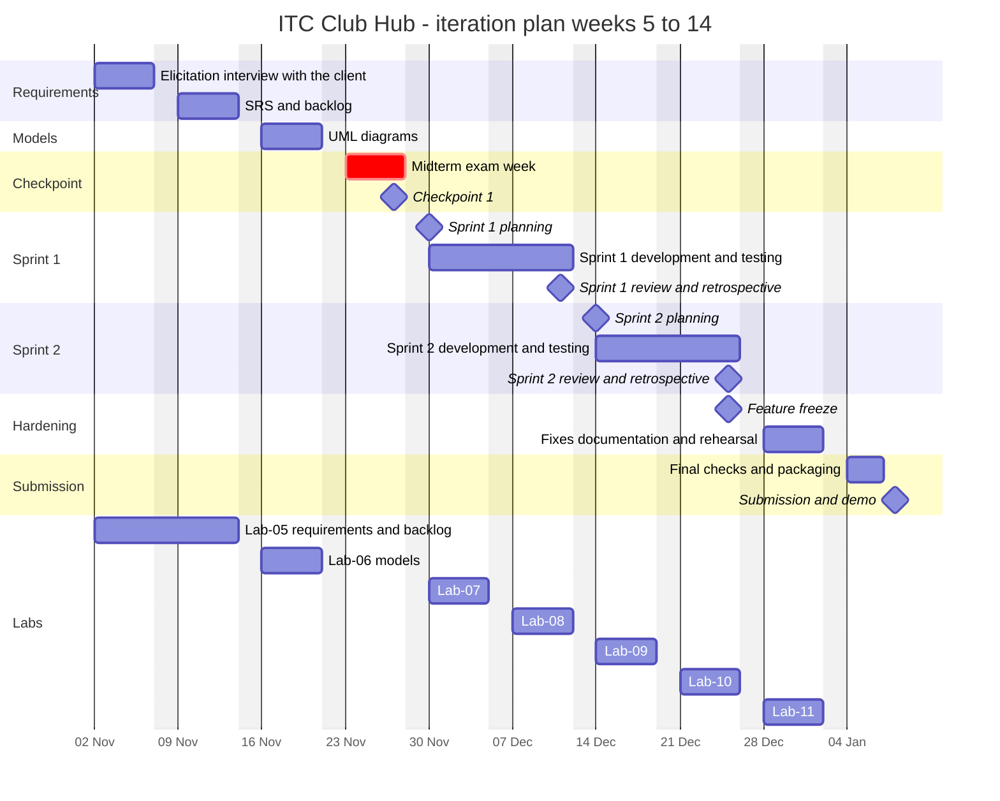

# Iteration Plan · Crayon Munchers · Weeks 5–14

Version: 1.1 draft · 2026-11-26

The schedule is based on the **IES Academic Calendar 2026-2027**, page 1, and the semester week numbering for **Y2, Y3 and Y4**. Week 1 begins on Monday **5 October 2026**, and week 5 begins on Monday **2 November 2026**. The dates in the assignment template have been adjusted forward by 28 days.

The proposed submission and demonstration date is **Friday 8 January 2027**, pending confirmation by the TA. All activities are recorded against their planned semester weeks.

The plan implements the [team's process decision](process-decision.md) through two two-week sprints followed by a hardening phase under feature freeze. Implementation covers the C++ core, command-line interface (CLI) and CSV storage. Web and mobile interfaces, reminders and offline QR check-in are included in the modelling scope.

## Weekly schedule

| Semester week | Monday–Friday | Main work | Lab work | Milestone |
|---------------|---------------|-----------|----------|-----------|
| 5 | 2–6 Nov 2026 | Client elicitation and clarification of business rules | Lab-05 begins | — |
| 6 | 9–13 Nov 2026 | SRS, acceptance criteria and product backlog | Lab-05 finishes | — |
| 7 | 16–20 Nov 2026 | UML models and interfaces | Lab-06 | — |
| 8 | 23–27 Nov 2026 | Midterm examination and checkpoint preparation | — | Checkpoint 1 on Friday 27 Nov |
| 9 | 30 Nov–4 Dec 2026 | Sprint 1 development and testing | Lab-07 | Planning on Monday 30 Nov |
| 10 | 7–11 Dec 2026 | Sprint 1 integration, testing and demonstration | Lab-08 | Review and retrospective on Friday 11 Dec |
| 11 | 14–18 Dec 2026 | Sprint 2 development and testing | Lab-09 | Planning on Monday 14 Dec |
| 12 | 21–25 Dec 2026 | Sprint 2 integration, testing and demonstration | Lab-10 | Review and retrospective on Friday 25 Dec; feature freeze |
| 13 | 28 Dec 2026–1 Jan 2027 | Defect resolution, regression testing, documentation and demonstration rehearsal | Lab-11 | Feature freeze maintained |
| 14 | 4–8 Jan 2027 | Final checks, submission and demonstration | — | Submission and demonstration planned for Friday 8 Jan |

The assignment specifies Lab-05 in weeks 5–6 and Lab-11 in week 13. The proposed intermediate allocation places Lab-06 in week 7 and Lab-07 through Lab-10 in weeks 9 through 12, subject to confirmation against the course timetable.

## Mermaid Gantt chart

The chart presents Monday–Friday activity windows with weekends excluded. Each sprint contains ten weekdays. Sprint development begins after the week-8 examination and checkpoint period. Public holidays are addressed in the availability assumptions below.

### Calendar notes

- **Water Festival falls on 23–25 November**, during week 8. This week is reserved for examination and checkpoint activities. The midterm examination bar and Friday checkpoint follow the assignment schedule; their exact appointments require confirmation by the TA.
- Independence Day falls on 9 November, during the requirements phase. Client consultation and backlog preparation will be scheduled around this holiday.
- Peace Day on 29 December and New Year's Day on 1 January fall within the hardening phase. Hardening activities are allocated to 28, 30 and 31 December. Victory Day falls on 7 January; the submission package is therefore scheduled for completion by 6 January ahead of the proposed 8 January demonstration.
- Both sprints fall within periods without weekday public holidays listed in the calendar. Member availability and the estimated 48 person-hours will be reviewed during sprint planning.

## Iteration goals

The following candidate features form the basis for sprint planning. The team will confirm story selection and effort estimates at the start of each sprint.

| Iteration | Weeks | Goal | Candidate features | Capacity | Exit criterion |
|-----------|-------|------|--------------------|----------|----------------|
| Sprint 1 | 9–10 | Enable students to browse upcoming events from approved clubs, register and cancel through the CLI. | Event browsing; registration with capacity, duplicate and past-event validation; cancellation with the 24-hour cutoff and seat release; CSV persistence; predefined club and event data. | 5 × 6 h/week × 2 weeks × 0.8 = **48 person-hours** | Browsing, registration and cancellation are demonstrated to the TA; registration data persists across application restarts; business-rule and integration tests pass in CI; the build produces zero warnings; implementation has passed pull-request review. |
| Sprint 2 | 11–12 | Enable club staff to publish events, record attendance and view monthly activity totals. | Basic CLI event publication for approved clubs; attendance recording; monthly totals per club; CSV persistence; approved corrections from the Sprint 1 review. | 5 × 6 h/week × 2 weeks × 0.8 = **48 person-hours** | The complete event publication, registration, attendance and reporting flow is demonstrated to the TA; publication by unapproved clubs is rejected; monthly totals are verified using synthetic data; tests pass in CI; the build produces zero warnings; implementation has passed pull-request review. |
| Hardening | 13 | Stabilise implemented features and prepare the final demonstration. | Defect resolution, regression testing, documentation and demonstration rehearsal under feature freeze. | 5 × 6 h/week × 1 week × 0.8 × 3/5 available weekdays = **14.4 person-hours** | Demonstration-blocking defects are resolved; the clean build and regression tests pass; setup instructions are verified from a clean checkout; the demonstration has been rehearsed. |
| Submission | 14 | Submit the project deliverables and demonstrate the agreed functionality. | Final verification, packaging and demonstration of implemented features. | 5 × 6 h/week × 1 week × 0.8 × 4/5 available weekdays = **19.2 person-hours** | The submission package is complete by 6 January, at least 24 hours before the proposed demonstration; required artifacts are submitted and the demonstration is delivered. |

## Capacity and scope assessment

Capacity estimates assume five members contributing six hours per week, consistent with the [communication-overhead estimate](../lab-01/communication-overhead.md). This availability assumption will be reviewed during sprint planning.

For each sprint:

`5 members × 6 hours/week × 2 weeks = 60 person-hours gross`

`60 × 0.8 = 48 person-hours planned capacity`

The 0.8 focus factor reserves 12 person-hours per sprint for interruptions and uncertainty. The resulting 48 person-hours include laboratory deliverables, sprint meetings, implementation, testing and review.

Hardening and submission capacity estimates assume an even distribution of the six weekly hours across five weekdays. Public holidays reduce the available weekdays to three in week 13 and four in week 14. These estimates will be revised if the team confirms a different availability pattern. Each sprint retains a planned capacity of 48 person-hours.

The preliminary effort allocation is presented below and will be reviewed during sprint planning.

| Work | Sprint 1 person-hours | Sprint 2 person-hours |
|------|---------------------:|---------------------:|
| Lab deliverables during the sprint | 8 | 8 |
| Sprint planning, coordination, review and retrospective | 4 | 4 |
| Browsing and initial CSV storage integration | 8 | — |
| Registration and its business rules | 14 | — |
| Cancellation and seat release | 6 | — |
| Basic event publication for approved clubs | — | 8 |
| Attendance recording and persistence | — | 10 |
| Monthly club activity totals | — | 6 |
| Automated tests, integration, PR review and review fixes | 8 | 12 |
| **Total** | **48** | **48** |

The allocation assumes narrowly scoped CLI stories and an operational CMake build, CI pipeline and test framework before Sprint 1. Production authentication, web interfaces, QR scanning, reminders, payments and hosting remain outside the sprint implementation scope. All test datasets will contain synthetic records.

If revised estimates exceed capacity, the team will reduce story size or return unfinished candidate work to the product backlog. Sprint 2 estimates will be reviewed following the Sprint 1 review. Changes to required scope will be agreed with the TA. The week-13 hardening phase is reserved for stabilisation, documentation and demonstration preparation under feature freeze.

## Sprint meeting agendas

- **Sprint planning, first Monday:** establish the sprint goal, review member availability and laboratory commitments, estimate candidate stories, select work within capacity and assign responsibilities.
- **Weekly coordination:** report completed work, planned activities and blockers. Blockers arising between meetings will be reported through Telegram.
- **Sprint review, last Friday:** demonstrate completed functionality to the client or TA and record feedback and acceptance decisions in the product backlog.
- **Sprint retrospective, last Friday:** review the iteration and agree on one actionable process improvement for the next iteration.

## Validation and outstanding confirmations

- [x] Week-5 commencement verified against the academic calendar: Monday 2 November 2026.
- [ ] TA confirmation of the checkpoint and submission/demonstration appointments; proposed dates are Friday 27 November and Friday 8 January.
- [ ] Intermediate laboratory allocation verified against the course timetable.
- [x] Mermaid chart rendered and visually inspected using Mermaid 11.12.2 in an offline browser.
- [x] Each sprint verified to contain ten weekdays, with Monday planning and Friday review milestones in the specified semester weeks.
- [x] Sprint development verified to follow the week-8 examination period; the plan concludes in week 14.
- [ ] Sprint goals and capacity estimates reviewed and agreed by the team.

Task reference: Lab-04, Task 4 — Iteration plan for weeks 5–14.
