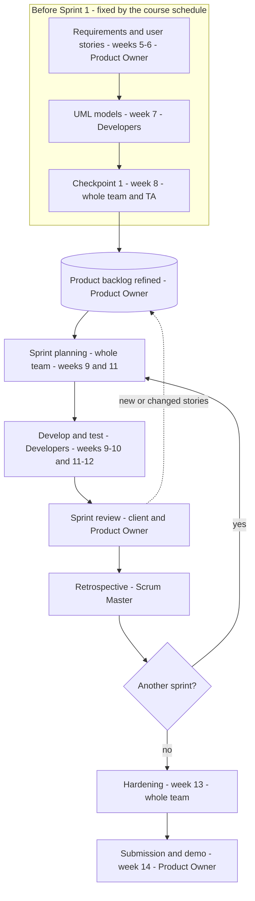

# PDR-001 · Development process for ITC Club Hub
Status: Proposed | Accepted | Superseded by PDR-00_
Date: 2026-11-20        Deciders: Ung Phearakleap, Yam Soksopheakna, Ou Pechly, Kouch Souyheng, Buntong Anupheap

## Context
1. The team consists of 5 members in which the scrum master rotates each sprint. (source: lab01/team-charter.md)
2. There are two fixed milestones: checkpoint 1 in week 8 and submission and demo in week 14. (source: slides, course curriculum)
3. Most of the members know of plan-driven work from other courses, but nobody has ever run sprints before, and C++ 20 and CMake are being learned in this course (source: lab01/team-charter.md and Task 2 scores in lab04/process-comparison.md)
4. Work must be finished 24 hours before each deadline (source: lab01/team-charter.md).
5. The system stores personal data such as student ID, name, email, and an optional phone number and attendance records. Test files such as tests/data/events.csv must therefore contain invented data only, and reviewers check this in every pull request (source: lab-03/data-inventory)

## Options considered
| Option                       | Weighted score (Task 2) | Pros | Cons |
|------------------------------|------------------------:|------|------|
| A. Waterfall                 | 2.00                    | 	Familiar to the team, clear documents and phases | Nothing works until late and the client sees the product only at the end, so a wrong rule is found in week 14 |
| B. Incremental delivery      | 3.16                    | Small step from plan-driven work, a demonstrable core after the first increment | Requirements are mostly fixed per increment, so changes after a review are awkward to absorb |
| C. Scrum-style iterative     | 3.40                    | Reviews every two weeks expose misunderstandings early, backlog absorbs changing requirements | Sprints and roles are new to the team, only two sprints leave little room to recover |
| D. No defined process        | n/a                     | No planning overhead | Five people with 6 h a week each, no shared plan, work may be duplicated, rules are not tested and the week 8 and 14 milestones are at risk |

## Decision
We will use Scrum-style iterative development: two sprints of two weeks (weeks 9-10 and 11-12), each with planning, development and testing, a review with the client and a retrospective, working from a product backlog that the Product Owner keeps up to date. This is the Task 2 winner, and the sensitivity check in Task 2 did not change the winner, so the decision follows our own scoring. Weeks 5-8 and week 14 are fixed by the course schedule and are not a different process: in weeks 5-8 we build and refine the product backlog that Sprint 1 starts from, and week 13 is a short hardening week before the demo.

| Element | Reference practice | Our tailoring | Reason |
|---------|--------------------|---------------|--------|
| Up-front work | Scrum starts from a product backlog | Weeks 5-8 build the backlog before Sprint 1: interview and SRS in weeks 5-6, user stories and UML models in week 7, backlog refined after checkpoint 1 in week 8, no code is committed to a sprint before then | Requirements are vague in week 4, and the course fixes these deliverables and checkpoint 1 in week 8 |
| Iteration length | Scrum sprints of 1-4 weeks | Two sprints of 2 weeks (weeks 9-10 and 11-12) | The client is available for a review about every two weeks and the semester leaves room for only two |
| Meetings | Daily scrum, planning, review, retrospective | One weekly team meeting on Google Meet that doubles as a short stand-up, plus planning on the first Monday and review and retrospective on the last Friday of each sprint, daily questions go to Telegram | The team has no time to meet daily, and the charter already sets Telegram answers within 12 hours on weekdays |
| Roles | Product Owner, Scrum Master, Developers | Phearakleap is Product Owner and talks to the client, Scrum Master is Anupheap in Sprint 1 and Phearakleap in Sprint 2, the others are Developers with their shared hats | Matches the team charter, which fixes the Product Owner and rotates the Scrum Master |
| Documents | Minimal documentation | Keep SRS, backlog, UML models, PDR records and a README per lab, no other formal documents | The course grades these artifacts, and anything else costs hours we do not have |
| Definition of Done | Team-defined | A story is done when the code builds with zero warnings, is merged by its author through a pull request after one review within 24 hours, its unit tests pass in CI and the TA accepted it at the review | Business rules (capacity, duplicates, 24 h, past events, approved clubs) must be tested |
| Hardening | Release or stabilisation sprint | Week 13 has bug fixes, documentation and demo rehearsal only, feature freeze at the end of week 12 | Protects the week 14 demo from last-minute features |

## Consequences

Positive:
- The client sees working software after weeks 10 and 12, so wrong assumptions about the rules show up early.
- Changes requested at a review go into the product backlog instead of breaking a fixed plan.
- A clear Definition of Done and pull-request reviews make every member's contribution visible in Git.
- The week 8 and week 14 milestones are planned from the start.

Negative / risks (with mitigation):
- Nobody has run sprints before. Mitigation: keep ceremonies short, write the agenda for each in lab04/iteration-plan.md and let the Scrum Master follow it.
- Only two sprints, so a story that slips from Sprint 1 leaves one more chance. Mitigation: plan Sprint 1 at no more than the computed capacity and put the riskiest rules (capacity, duplicates, 24 h cancellation) first.
- The TA is available only about 30 minutes a week, so a review can be missed. Mitigation: book the review dates in week 9 and send questions in writing between reviews.
- Weeks 5-8 produce documents and the backlog and include the midterm, so little code exists before Sprint 1. Mitigation: set up CMake, CI and the GoogleTest smoke test now (Task 5) so the team can start coding on day one of Sprint 1.

## Process diagram (source: lab04/process.mmd)

## Approvals
- Ung Phearakleap, 20/11/2026: approved
- Yam Soksopheakna, 20/11/2026: approved
- <member>, <date>: approved
- <member>, <date>: approved
- <member>, <date>: approved